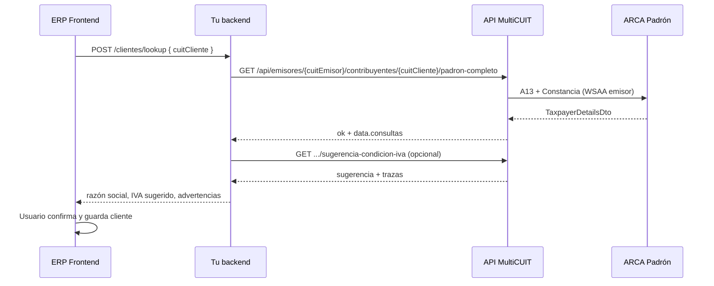

# Guía — Consulta de padrón ARCA desde API externa (ERP / clientes)

Documento para integrar **alta y validación de clientes** en tu ERP: al ingresar un CUIT, consultar datos en el **padrón ARCA** (razón social, régimen, sugerencia de condición IVA) vía la API MultiCUIT.

**Última actualización:** 2026-05-22.

**Guía general de facturación:** [`GUIA_INTEGRACION_API_EXTERNA.md`](./GUIA_INTEGRACION_API_EXTERNA.md)

---

## Índice

1. [¿Está implementado?](#1-está-implementado)
2. [Requisitos previos](#2-requisitos-previos)
3. [Conceptos: emisor vs receptor](#3-conceptos-emisor-vs-receptor)
4. [Endpoints disponibles](#4-endpoints-disponibles)
5. [Cuál endpoint usar en tu ERP](#5-cuál-endpoint-usar-en-tu-erp)
6. [Respuestas y campos útiles](#6-respuestas-y-campos-útiles)
7. [Extraer razón social y datos para el formulario](#7-extraer-razón-social-y-datos-para-el-formulario)
8. [Condición IVA sugerida](#8-condición-iva-sugerida)
9. [Flujo recomendado — alta de cliente](#9-flujo-recomendado--alta-de-cliente)
10. [Ejemplos HTTP (curl y Node.js)](#10-ejemplos-http-curl-y-nodejs)
11. [Errores frecuentes](#11-errores-frecuentes)
12. [Límites, costos y buenas prácticas](#12-límites-costos-y-buenas-prácticas)

---

## 1. ¿Está implementado?

**Sí.** El backend consulta padrón ARCA con el SDK `@arcasdk/core`, usando las **credenciales (certificado + clave) del CUIT emisor** registrado en MultiCUIT.

| Capacidad | ¿API externa? | Ruta |
|-----------|---------------|------|
| Detalle de padrón (un alcance) | Sí, con API key | `GET .../padron?alcance=` |
| Detalle combinado A13 + constancia | Sí (recomendado) | `GET .../padron-completo` |
| Sugerencia condición IVA receptor | Sí (heurística) | `GET .../sugerencia-condicion-iva` |
| Padrón al emitir factura | Sí (opcional) | `consultarSugerenciaCondicionIva: true` en `POST /api/facturas` |

El **Dashboard** ya usa `padron-completo` para mostrar un resumen al verificar CUITs en cartera (`ClientesPage`). Tu ERP puede hacer lo mismo desde el servidor.

---

## 2. Requisitos previos

| Requisito | Detalle |
|-----------|---------|
| **API key** | `Authorization: Bearer mck_…` o `X-API-Key` (misma auth que facturación). |
| **CUIT emisor** | Uno de los CUITs de tu organización, con **certificados válidos** importados en el facturador. |
| **Permisos WSAA del certificado** | El certificado del emisor debe estar autorizado en ARCA para los **alcances de padrón** que consultás (típico: **A13** `thirteen` y **constancia** `inscription_proof`). |
| **Feature del plan** | La organización debe tener **`padron_habilitado`** en su plan/cuota. Si no: **403** `QUOTA_FEATURE_DISABLED`. |
| **Ambiente** | Homologación o producción según `AFIP_ENV` del servidor y certs del emisor (igual que facturas). |

Verificá en **`GET /api/admin/me`** que el CUIT emisor figure en `empresas` y que el plan incluya padrón (si el payload de cuota lo expone en tu despliegue).

---

## 3. Conceptos: emisor vs receptor

En la URL aparecen **dos CUITs**:

| Parámetro | Rol | Ejemplo en alta de cliente |
|-----------|-----|----------------------------|
| `:cuitEmisor` | Empresa **tuya** que factura (tiene certificado en MultiCUIT) | `20322803851` |
| `:cuitReceptor` | CUIT del **cliente** que querés consultar en padrón | `30712345678` |

```
GET /api/emisores/20322803851/contribuyentes/30712345678/padron-completo
              └─ tu CUIT emisor ─┘              └── CUIT del cliente ──┘
```

ARCA devuelve datos del **receptor** usando el ticket WSAA del **emisor**. No podés consultar padrón de un CUIT emisor que no pertenezca a tu organización o sin certificados.

---

## 4. Endpoints disponibles

Base: `{BASE}/api/emisores/:cuitEmisor/contribuyentes/:cuitReceptor/...`

### 4.1 `GET .../padron?alcance=`

Consulta **un** alcance de padrón por request.

**Query `alcance`** (opcional; si se omite, el servidor usa `PADRON_ALCANCE` del `.env` o default **five**):

| Valor | Servicio ARCA |
|-------|----------------|
| `four` | Padrón A4 |
| `five` | Padrón A5 |
| `ten` | Padrón A10 |
| `thirteen` | Padrón A13 (datos generales habituales) |
| `inscription_proof` | Constancia de inscripción (impuestos / régimen) |

Alias aceptados: `a13`, `13`, `constancia`, `inscripcion`, etc. (ver `parsePadronAlcance` en el código).

**Respuesta 200:**

```json
{
  "ok": true,
  "alcancePadron": "thirteen",
  "detalle": { },
  "trazas": ["Contribuyente encontrado en padrón."]
}
```

- `detalle`: objeto **`TaxpayerDetailsDto`** de `@arcasdk/core`, o `null` si no hay datos en ese alcance.
- Si el certificado **no** tiene autorizado ese alcance, suele fallar con error 500/502 y mensaje en logs (p. ej. `notAuthorized`).

### 4.2 `GET .../padron-completo` (recomendado para ERP)

Ejecuta en **paralelo** A13 + constancia de inscripción y devuelve ambas respuestas.

**Respuesta 200 — éxito total o parcial:**

```json
{
  "ok": true,
  "parcial": false,
  "data": {
    "cuitEmisor": 20322803851,
    "cuitReceptor": 30712345678,
    "consultas": [
      {
        "alcancePadron": "thirteen",
        "ok": true,
        "reason": "success",
        "detalle": { }
      },
      {
        "alcancePadron": "inscription_proof",
        "ok": true,
        "reason": "success",
        "detalle": { }
      }
    ],
    "trazas": [
      "Alcance thirteen: contribuyente encontrado.",
      "Alcance inscription_proof: contribuyente encontrado."
    ]
  }
}
```

| Campo | Significado |
|-------|-------------|
| `parcial` | `true` si al menos un alcance falló o vino vacío, pero **otro** sí respondió. |
| `consultas[].reason` | `success` · `empty_result` · `service_error` (con `error` texto). |
| `consultas[].detalle` | `TaxpayerDetailsDto` o `null`. |

**Respuesta 502** — ambos alcances fallaron:

```json
{
  "ok": false,
  "error": {
    "code": "PADRON_MULTI_SCOPE_FAILED",
    "message": "Fallaron todas las consultas de padrón (A13 y constancia).",
    "details": { "consultas": [], "trazas": [] }
  }
}
```

### 4.3 `GET .../sugerencia-condicion-iva?alcance=`

No reemplaza el padrón completo: **siempre** consulta A13 + constancia, fusiona datos y aplica una **heurística** para proponer `condicionIvaReceptor` (código 1–10 usado en facturas).

**Query `alcance`:** opcional, solo documenta preferencia de UI; la estrategia real es `dual_merge_thirteen_inscription_proof`.

**Respuesta 200:**

```json
{
  "ok": true,
  "sugerencia": 1,
  "trazas": ["..."],
  "advertencias": ["La sugerencia es orientativa; confirmar con el contador."],
  "alcancePadron": "thirteen",
  "alcancePadronSolicitado": null,
  "padron": {
    "estrategia": "dual_merge_thirteen_inscription_proof",
    "consultas": [
      { "alcance": "thirteen", "estado": "ok", "detalleDisponible": true },
      { "alcance": "inscription_proof", "estado": "ok", "detalleDisponible": true }
    ],
    "regimenGeneralFuente": "inscription_proof"
  }
}
```

| `sugerencia` | Condición IVA (para `condicionIvaReceptor` en factura) |
|--------------|--------------------------------------------------------|
| 1 | Responsable inscripto |
| 4 | Exento |
| 5 | Consumidor final |
| 6 | Monotributo |
| 7 | No categorizado |
| 8 | No responsable |
| 9 | Monotributo social |
| 10 | Monotributo trabajador independiente |
| `null` | Sin datos suficientes en padrón |

---

## 5. Cuál endpoint usar en tu ERP

| Caso de uso | Endpoint |
|-------------|----------|
| Formulario “Nuevo cliente”: autocompletar razón social, tipo persona, actividad | **`padron-completo`** |
| Solo validar que el CUIT existe en ARCA | `padron?alcance=thirteen` |
| Prellenar **condición IVA** al facturar | **`sugerencia-condicion-iva`** (o flag en preview/emisión) |
| Máximo detalle fiscal (impuestos, monotributo) | `padron-completo` y leer `detalle` de **constancia** |

**No** hace falta llamar padrón desde el navegador: tu backend recibe el CUIT del usuario y llama al facturador.

---

## 6. Respuestas y campos útiles

El objeto `detalle` sigue la forma **`TaxpayerDetailsDto`** del SDK ARCA. Los nombres pueden variar según persona física/jurídica y alcance; campos habituales:

### 6.1 Identificación y nombre

| Ruta en `detalle` | Uso |
|-------------------|-----|
| `idPersona` | CUIT / id persona |
| `tipoPersona` | `FISICA` / `JURIDICA` |
| `estadoClave` | Estado de la clave fiscal |
| `datosGenerales.razonSocial` | Razón social (jurídica) |
| `datosGenerales.nombre` + `datosGenerales.apellido` | Persona física |
| `datosGenerales.fechaInicioActividad` | Inicio actividades |
| `datosGenerales.descripcionActividadPrincipal` | Actividad principal |

### 6.2 Régimen e impuestos

| Ruta | Uso |
|------|-----|
| `datosRegimenGeneral.impuesto[]` | Lista de impuestos (IVA id 30, exento 32, etc.) |
| `datosMonotributo` | Si es monotributista (categoría, etc.) |
| `domicilioFiscal` / domicilios en `datosGenerales` | Domicilio (según alcance) |

La **constancia** (`inscription_proof`) suele traer mejor `datosRegimenGeneral.impuesto`; **A13** (`thirteen`) suele traer mejor datos generales y nombre.

### 6.3 Ejemplo real simplificado (`detalle`)

```json
{
  "idPersona": 30712345678,
  "tipoPersona": "JURIDICA",
  "estadoClave": "ACTIVO",
  "datosGenerales": {
    "razonSocial": "CLIENTE DEMO SA",
    "fechaInicioActividad": "2010-03-15",
    "descripcionActividadPrincipal": "Servicios de consultoría"
  },
  "datosRegimenGeneral": {
    "impuesto": [
      {
        "idImpuesto": 30,
        "descripcionImpuesto": "IVA",
        "estadoImpuesto": "AC",
        "periodo": 202401
      }
    ]
  }
}
```

---

## 7. Extraer razón social y datos para el formulario

El backend **no** aplana el padrón a un DTO fijo en la API HTTP: devuelve `detalle` crudo del SDK. En tu ERP conviene una función de mapeo.

### 7.1 Lógica recomendada (alineada al CLI del repo)

Prioridad usada en `queryPadronCompleto.ts`:

1. Tomar la primera consulta exitosa en `padron-completo` (`reason === 'success'` y `detalle` no nulo), preferir **`thirteen`** y si falta nombre usar **`inscription_proof`**.
2. **Razón social:** `datosGenerales.razonSocial`, o `nombre` + `apellido` concatenados.
3. **Actividad:** `datosGenerales.descripcionActividadPrincipal` o primer ítem de `datosRegimenGeneral.actividad`.
4. **Impuestos:** hasta N entradas de `datosRegimenGeneral.impuesto` para mostrar en UI.

### 7.2 Ejemplo TypeScript (ERP)

```typescript
type PadronDetalle = Record<string, unknown>;

function readString(v: unknown): string | null {
  return typeof v === 'string' && v.trim().length > 0 ? v.trim() : null;
}

function isRecord(v: unknown): v is Record<string, unknown> {
  return v != null && typeof v === 'object';
}

/** Extrae campos de UI desde TaxpayerDetailsDto (un alcance). */
export function mapDetallePadronACliente(detalle: PadronDetalle) {
  const dg = isRecord(detalle.datosGenerales) ? detalle.datosGenerales : {};
  const drg = isRecord(detalle.datosRegimenGeneral) ? detalle.datosRegimenGeneral : {};
  const nombre = [readString(dg.nombre), readString(dg.apellido)].filter(Boolean).join(' ');
  const razonSocial =
    readString(dg.razonSocial) ?? (nombre.length > 0 ? nombre : null);

  const impuestos = Array.isArray(drg.impuesto)
    ? drg.impuesto.filter(isRecord).slice(0, 6).map((i) => ({
        id: i.idImpuesto ?? i.id ?? null,
        descripcion: readString(i.descripcionImpuesto) ?? readString(i.descripcion),
        estado: i.estadoImpuesto ?? i.estado ?? null,
      }))
    : [];

  return {
    cuit: detalle.idPersona ?? null,
    tipoPersona: readString(detalle.tipoPersona),
    estadoClave: readString(detalle.estadoClave),
    razonSocial,
    inicioActividades:
      readString(dg.fechaInicioActividad) ??
      readString(dg.fechaInicioActividades) ??
      null,
    actividadPrincipal: readString(dg.descripcionActividadPrincipal),
    impuestos,
    esMonotributo: detalle.datosMonotributo != null,
  };
}

/** Tras GET padron-completo: elige el mejor detalle entre consultas. */
export function mejorDetalleDesdePadronCompleto(data: {
  consultas: Array<{
    alcancePadron: string;
    ok: boolean;
    reason: string;
    detalle: PadronDetalle | null;
  }>;
}): PadronDetalle | null {
  const orden = ['thirteen', 'inscription_proof', 'five', 'ten', 'four'];
  for (const alcance of orden) {
    const c = data.consultas.find(
      (x) => x.alcancePadron === alcance && x.ok && x.reason === 'success' && x.detalle,
    );
    if (c?.detalle) return c.detalle;
  }
  return null;
}
```

### 7.3 Respuesta sugerida a tu frontend

Tu API interna puede devolver algo así (vos definís el contrato):

```json
{
  "cuit": "30712345678",
  "razonSocial": "CLIENTE DEMO SA",
  "tipoPersona": "JURIDICA",
  "estadoClave": "ACTIVO",
  "actividadPrincipal": "Servicios de consultoría",
  "condicionIvaSugerida": 1,
  "condicionIvaSugeridaLabel": "Responsable inscripto",
  "padronParcial": false,
  "advertencias": ["Confirmar condición IVA con estudio contable."]
}
```

---

## 8. Condición IVA sugerida

Para el campo **`condicionIvaReceptor`** del JSON de factura (`POST /api/facturas`):

1. Llamá **`GET .../sugerencia-condicion-iva`** con el mismo par de CUITs, **o**
2. En preview/emisión: `"consultarSugerenciaCondicionIva": true` (solo si `docTipo` 80 y `docNro` de 11 dígitos).

La sugerencia es **orientativa**; el usuario puede elegir otro código. Las `trazas` y `advertencias` explican el criterio (monotributo, IVA 30, exento, etc.).

---

## 9. Flujo recomendado — alta de cliente



### Pasos concretos

1. Usuario elige **empresa emisora** (CUIT con el que facturará) o usá una por defecto de la sesión ERP.
2. Usuario ingresa **CUIT del cliente** (11 dígitos).
3. Tu backend llama **`padron-completo`**.
4. Si `ok` y hay `detalle`, mapeás razón social y mostrás formulario prellenado.
5. Opcional: **`sugerencia-condicion-iva`** para guardar `condicionIvaReceptor` en tu maestro de clientes.
6. Guardás en **tu** base; MultiCUIT no persiste “clientes” del ERP (solo empresas emisoras de la org).
7. Al emitir factura, enviás `docNro` + `condicionIvaReceptor` que guardaste (o volvés a consultar sugerencia).

### Validaciones en tu ERP

- CUIT receptor: 11 dígitos, dígito verificador (opcional pero recomendado).
- No consultar padrón en cada tecla: **debounce** 400–600 ms o botón “Buscar en ARCA”.
- Cache corto en memoria (ej. 5–15 min por CUIT) para no saturar ARCA ni rate limits.

---

## 10. Ejemplos HTTP (curl y Node.js)

Variables:

```powershell
$BASE = "https://api.tudominio.com"
$TOKEN = "mck_tu_key"
$CUIT_EMISOR = "20322803851"    # tu empresa en MultiCUIT
$CUIT_CLIENTE = "30712345678"   # cliente a dar de alta
```

### 10.1 Padrón completo (recomendado)

```powershell
curl.exe -sS "$BASE/api/emisores/$CUIT_EMISOR/contribuyentes/$CUIT_CLIENTE/padron-completo" `
  -H "Authorization: Bearer $TOKEN"
```

### 10.2 Un solo alcance (A13)

```powershell
curl.exe -sS "$BASE/api/emisores/$CUIT_EMISOR/contribuyentes/$CUIT_CLIENTE/padron?alcance=thirteen" `
  -H "Authorization: Bearer $TOKEN"
```

### 10.3 Sugerencia condición IVA

```powershell
curl.exe -sS "$BASE/api/emisores/$CUIT_EMISOR/contribuyentes/$CUIT_CLIENTE/sugerencia-condicion-iva" `
  -H "Authorization: Bearer $TOKEN"
```

### 10.4 Cliente Node.js (módulo reutilizable)

```javascript
const BASE = process.env.MULTICUIT_API_BASE_URL.replace(/\/$/, '');
const KEY = process.env.MULTICUIT_API_KEY;

async function multicuitGet(path) {
  const res = await fetch(`${BASE}${path}`, {
    headers: { Authorization: `Bearer ${KEY}` },
  });
  const json = await res.json();
  if (!res.ok) {
    const err = new Error(json?.error?.message ?? res.statusText);
    err.status = res.status;
    err.code = json?.error?.code;
    err.body = json;
    throw err;
  }
  return json;
}

/** Alta de cliente: padrón + sugerencia IVA */
export async function lookupClienteArca(cuitEmisor, cuitCliente) {
  const padron = await multicuitGet(
    `/api/emisores/${cuitEmisor}/contribuyentes/${cuitCliente}/padron-completo`,
  );
  let sugerencia = null;
  try {
    sugerencia = await multicuitGet(
      `/api/emisores/${cuitEmisor}/contribuyentes/${cuitCliente}/sugerencia-condicion-iva`,
    );
  } catch {
    // opcional: seguir sin sugerencia
  }
  return { padron, sugerencia };
}

// Ejemplo en ruta Express
// app.get('/erp/clientes/arca/:cuit', async (req, res) => {
//   const cuitEmisor = process.env.CUIT_EMISOR_DEFAULT;
//   const out = await lookupClienteArca(cuitEmisor, req.params.cuit.replace(/\D/g, ''));
//   res.json(out);
// });
```

### 10.5 Prueba local sin HTTP (operadores)

Desde `multicuit/backend`:

```bash
pnpm run padron:completo -- -- 20322803851 30712345678
pnpm run padron:completo -- -- --json --compact 20322803851 30712345678
```

---

## 11. Errores frecuentes

| HTTP | Código | Causa | Acción |
|------|--------|-------|--------|
| 400 | `INVALID_CUIT` | CUIT distinto de 11 dígitos | Validar entrada |
| 401 | `AUTH_*` | Sin key o key inválida | Revisar Bearer |
| 403 | `CUIT_NO_AUTORIZADO` | Emisor no es de tu org | Usar CUIT de `GET /api/admin/me` |
| 403 | `QUOTA_FEATURE_DISABLED` | Plan sin `padron_habilitado` | Contactar operador / upgrade plan |
| 422 | `EMPRESA_NO_REGISTRADA` | Emisor no en DB | Alta de empresa en facturador |
| 502 | `PADRON_MULTI_SCOPE_FAILED` | Cert sin A13/constancia o ARCA caído | Revisar autorizaciones del certificado |
| 500 | `INTERNAL_ERROR` | Cert vencido, WSAA, red | Ver logs con `requestId` |

Si `parcial: true`, mostrá datos del alcance que sí respondió y un aviso “consulta parcial”.

Mensajes típicos en `consultas[].error`: `notAuthorized` → el certificado del emisor no tiene ese servicio de padrón habilitado en ARCA.

---

## 12. Límites, costos y buenas prácticas

- Cada consulta consume **llamadas ARCA** (WSAA + servicio padrón): no abuses en autocomplete letra por letra.
- Respetá **rate limits** generales del API (`429`, `Retry-After`).
- Los datos de padrón son **confidenciales**: guardalos según tu política de datos personales / LGPD aplicable.
- La razón social en padrón puede **diferir** del nombre comercial que usa el cliente; permití edición manual antes de guardar.
- Para **consumidor final sin CUIT** no aplica padrón; usá `docTipo` 99 en factura.
- Documentación curl adicional: [`EJEMPLOS_CURL_API_WINDOWS_HOMO_PROD.md`](./EJEMPLOS_CURL_API_WINDOWS_HOMO_PROD.md) § Padrón.

---

## Documentación relacionada

| Archivo | Tema |
|---------|------|
| [`GUIA_INTEGRACION_API_EXTERNA.md`](./GUIA_INTEGRACION_API_EXTERNA.md) | Facturación A/B/C/E |
| [`GUIA_INTEGRACION_ERP_ENDPOINTS.md`](./GUIA_INTEGRACION_ERP_ENDPOINTS.md) | Listado endpoints §7 |
| [`GUIA_API_TERCEROS_ERP_DONWEB_MYSQL.md`](./GUIA_API_TERCEROS_ERP_DONWEB_MYSQL.md) | §8.4 padrón |
| [`clientes/GUIA_CLIENTES_AURIX.md`](./clientes/GUIA_CLIENTES_AURIX.md) | § Padrón ARCA |
